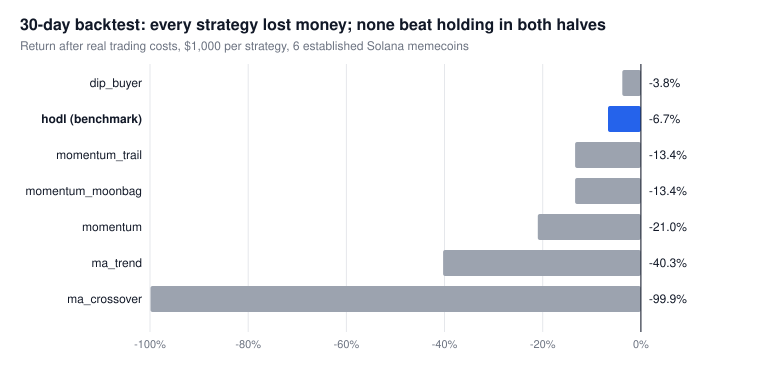
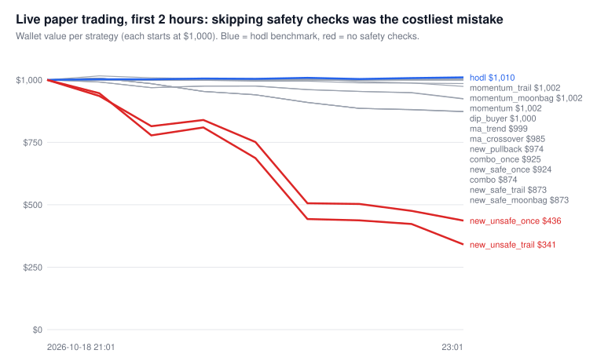

# Memecoin Paper-Trading Bot

A Python data pipeline that watches live Solana token markets, runs on-chain safety checks, simulates 15 trading strategies (including a buy-and-hold benchmark) side by side with **fake money** priced from real exchange quotes, logs everything to CSV, and replays a month of history in a backtester.

> **No real money, no wallet, no private keys.** Every trade is simulated. This is an engineering and data project, not a trading product or financial advice. Its main finding is that **no strategy beat simply holding** once realistic costs were included.



## What it does

```
 Data sources                 Safety checks              Simulated trades           Logs                  Analysis
 ─────────────                ─────────────              ────────────────           ────                  ────────
 DexScreener  (market data)                              15 strategies, each        trades.csv            backtest.py
 Jupiter      (live prices) ─► Helius RPC (on-chain): ─► with its own $1,000    ─►  equity.csv        ─►  replays 30 days of
 Helius       (new launches)   mint/freeze authority,    paper wallet; fills        scanned_coins.csv     1-minute candles
 GeckoTerminal(history)        transfer tax, holder      priced from real           state.json            (GeckoTerminal) with
                               concentration, liquidity  Jupiter quotes                                   the same rules
```

- **`paper_bot.py`**: the live bot. Every 3 seconds it pulls Jupiter prices and checks stop-losses and trailing stops. Every 30 seconds it pulls DexScreener market data and decides on buys. Every 60 seconds it scans for newly launched coins and safety-checks each one straight from the blockchain through the Helius RPC.
- **Realistic fills**: each simulated trade asks Jupiter for a real swap quote at that trade size, so pool fees and price impact are included. If a quote fails, the bot falls back to the coin's most recent real cost, then to a flat fee.
- **Resilience**: state is saved atomically so a crash can't corrupt it. File writes retry when OneDrive or Excel has a file locked. One bad API response is logged and skipped, not fatal. `run_bot.bat` restarts the bot if it ever exits. Sells that happen right after downtime are labelled, so they don't distort the results.
- **`backtest.py`**: replays one-minute price history for the established coins through the *same* strategy functions, using today's real trade costs. It reports results for each half of the period separately, so a strategy that only got lucky once stands out.
- **`make_charts.py`**: builds the charts in this README as SVG using only the standard library.

## Results

**Backtest, 30 days, 6 established coins** (full table: [`results/backtest_report_30d.txt`](results/backtest_report_30d.txt))

Every strategy lost money over the period, and so did simply holding the coins (`hodl`, -6.7%). One strategy, `dip_buyer`, lost less overall (-3.8%). Even so, it trailed holding badly in the first half (+8.9% vs +17.4%) and only came out ahead in the second half. That is not a consistent edge. The most active strategy, `ma_crossover`, made 1,253 trades, and fees and slippage wiped out almost the entire wallet.

**Live paper trading, first 2 hours** (sample: [`results/equity_sample.csv`](results/equity_sample.csv))



The clearest early signal came from the control group. The new-coin strategies that skipped the safety checks (red lines) lost 56–66% within two hours. The same rules *with* the checks lost 3–13%. Two hours is far too short to judge a strategy. It is enough to show the safety checks were doing real work.

**Honest conclusion:** after realistic costs, no strategy showed a reliable edge over buy-and-hold. The established-coin strategies were backtested over 30 days. The new-coin strategies can only be tested live, because coins that launch and die within hours leave no usable history. The value of the project is the pipeline and the testing method, not a money-making signal.

## Lessons learned

- **APIs go down, so plan for it.** RugCheck, the safety-check API I started with, shut down mid-project. I rebuilt the checks directly on raw blockchain data through the Helius RPC. Every external call now has a fallback, and an outage skips one round instead of crashing the bot.
- **Stale prices are a silent bug.** DexScreener data can be 30+ seconds old, which for a fast-moving new coin is a different price. The bot now uses DexScreener for *signals* but records trades at Jupiter's fresher price.
- **Fees decide everything.** Early runs used a flat 1% fee and looked better than they should have. Switching to real per-trade quotes, which include price impact, made frequent-trading strategies collapse. That is what really happens to them.
- **Test against a benchmark and a control group.** `hodl` shows whether a strategy beats doing nothing. The "unsafe" twins show whether the safety checks matter. Splitting results into two halves shows whether a win was luck.
- **Long-running scripts need boring robustness:** atomic saves, retry on locked files, auto-restart, and clear labels on data recorded during downtime.

## How these techniques apply to business work

The same building blocks are used in everyday business automation:

- **Price monitoring**: polling several APIs on a schedule, using whichever source is freshest, and alerting on threshold rules (competitor prices, supplier costs).
- **Inventory and data sync**: reconciling records from several sources that disagree or go offline, with retries and fallbacks.
- **Automated reporting**: logging to CSV and producing charts and a summary report without anyone touching a spreadsheet.

## How to run it

Requires **Python 3.10+**. No packages to install: everything uses the standard library.

```bash
git clone https://github.com/maxmckittrick1-oss/memecoin-paper-bot.git
cd memecoin-paper-bot
python paper_bot.py            # live paper trading (Ctrl+C to stop; progress is saved)
python paper_bot.py --reset    # start again with fresh $1,000 wallets
python backtest.py 30          # backtest the last 30 days (first run downloads data, a few minutes)
python make_charts.py          # redraw the README charts from the files in results/
```

On Windows, `run_bot.bat` runs the bot and restarts it automatically if it stops.

**Optional Helius key.** The new-coin scanner and its on-chain safety checks need a free [Helius](https://www.helius.dev) API key. Without one, the bot still trades the established coins. Copy `.env.example` to `.env` and put your key in it. `.env` is git-ignored, so the key never gets committed. You can also set the `HELIUS_API_KEY` environment variable instead.

## Project layout

```
paper_bot.py        live paper-trading bot (data, safety checks, strategies, wallets)
backtest.py         replays historical prices through the same strategies
make_charts.py      draws the README charts (SVG, no dependencies)
run_bot.bat         Windows auto-restart wrapper
results/            saved backtest report, a sample equity log, and the charts
.env.example        template for the optional API key
```

Run output (`trades.csv`, `equity.csv`, `state.json`, `data/`) is created locally and kept out of git.
